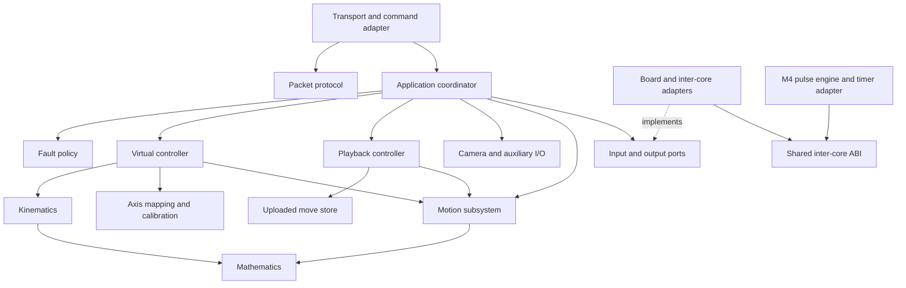

<!--
 Copyright 2026 cade.
 SPDX-License-Identifier: GPL-3.0-only
-->

# Modular firmware architecture

Status: proposed architecture and incremental migration plan, based on the
current `virtuals-test-suite` implementation. This document describes the target;
it does not imply that the modules below have already been extracted.

## Direction

Use small modules with explicit state ownership, value-based inputs and outputs,
and dependencies that point toward hardware-independent code. Keep the dual-core
split: M7 interprets commands and plans motion; M4 generates timed outputs.

Use **one motion subsystem with separate coordinated and independent planners**.
They need common axis state, limits, stop handling, and output timing, but have
different planning and handoff rules. A common interface should unify ownership
and execution without forcing both algorithms into one implementation.

In addition to packets, mathematics, kinematics, and motion, establish boundaries
for virtual control, playback and uploaded data, calibration, fault policy,
camera/GPIO sequencing, transport, and the inter-core link. These are logical
boundaries; each does not require a separate library, task, or abstract class.

## Current architecture and coupling

| Current location | Responsibilities and coupling |
| --- | --- |
| `m7/m7.ino` | Serial handling, dispatch, configuration, virtual state, playback, camera/GPIO, stops, reporting, motion updates, and shared-memory writes. These operate on the same global state. |
| `m7/dfx.h` | Mixes axis configuration, runtime state, trajectory storage, playback state, protocol scales, and macros that reach into global shared memory. |
| `m7/dmc_msg.*` | Incremental DMC parsing and response serialization, with global parser/output buffers. Command decoding and execution remain in the sketch. |
| `common/LimnmocoProtocol` | Host-tested complete-frame codec and initial typed virtual packet decoders. Not yet the firmware parser; no incremental stream parser or complete command/response coverage. |
| `common/LimnmocoIK` | Already contains reusable pure code, but combines vector/matrix math, geometry, calibration lookup, virtual target construction, wire conversion, and trajectory profiles. |
| `m7/motion.*` | Independent point-to-point planning, uploaded-track interpolation, and Go Motion/live-playback calculations. Functions mutate the broad `Motor` and playback structures. |
| `m7/coordinated_motion.*` | Coordinated execution and handoff with a private global state object; writes into the same `Motor` array used by independent motion and playback. |
| `m4/m4.ino` | Timer/GPIO setup, shared-memory consumption, pulse accumulation, pulse completion, and camera phase output. |

Specific pressures motivating the boundaries:

- `Motor` combines configuration, commanded position/velocity, and the private
  state of an independent trajectory. Coordinated motion clears fields belonging
  to that other planner to take control.
- Virtual target preparation, motion scheduling, and changes to logical aim
  state must succeed together. Splitting files alone will not establish that
  transaction.
- `updateMotorVelocities()` executes several motion modes, applies coupling,
  reconciles step counts, and publishes shared-memory output.
- `stopAll()` combines motion policy, repeated-stop escalation, playback state,
  frame alignment, and camera behavior.
- `DmcSharedData` is declared independently in both sketches. Its address and
  synchronization details are visible to application code.
- M4's accumulated steps are emitted-step accounting, not encoder measurements
  of the crane. Commanded and emitted positions must remain distinguishable.
- Serial tracing is embedded in kinematic reporting, and outgoing responses can
  be dropped when the current queue has insufficient room.

The existing [virtuals test-suite proposal](proposal_virtuals_test_suite.md)
provides the starting migration strategy. This plan expands its virtual
controller boundary to cover the rest of the firmware.

## Proposed module boundaries

### 1. Packet protocol

Own DMC framing, checksum, incremental stream assembly/resynchronization, typed
payload codecs, wire lengths, command identifiers, and response encoding.
Malformed bytes must fail before application state changes.

Keep two internal layers: a frame codec and command-specific payload codecs.
Accept byte buffers and return packets or structured errors. Do not read Serial,
own motors, decide whether a move is allowed, or schedule motion here.

Move `AimPointProtocol` and fixed-point wire scales out of the kinematics
library. Keep protocol representation separate from domain values: the command
adapter converts packet fields into typed axis IDs, poses, and configuration.
The existing `std::vector`/`std::string` host API is a useful starting reference;
the firmware path needs bounded buffers, explicit ownership/lifetimes, and no
per-tick allocation. Preserve convenient allocating wrappers for host tests if
useful.

### 2. Transport and command adapter

Transport owns serial reads/writes, bounded receive/transmit work, output queues,
and the existing diagnostic serial mirrors. It supplies bytes to the protocol
module and sends encoded responses. Define queue-full behavior explicitly;
reserve capacity or defer command acceptance when a required response cannot be
retained. Diagnostic traffic must not block motion execution.

The command adapter maps valid packets to domain requests and domain results to
DMC ACKs, replies, and asynchronous notifications. It owns request IDs and the
rule for exactly one immediate command outcome. Domain controllers must not
construct packets or carry DMC error constants.

These can be two components in the same firmware adapter package. Keeping their
interfaces separate allows protocol tests without Arduino and controller tests
without serialized packets.

### 3. Mathematics

Own general-purpose vectors, matrices, rotations, angle utilities, and narrowly
shared numerical helpers. Functions are pure and have no crane, motor, protocol,
or Arduino dependency. State units and rotation conventions at API boundaries.

Move the existing shared `Vec3`/`Mat3` implementation here; retire M7 forwarding
wrappers after consumers migrate. Crane-specific coordinate mappings belong to
kinematics. Trajectory equations belong to motion, even though they use math.

### 4. Kinematics and coordinate geometry

Own pure FK/IK, crane geometry, nodal offsets, coordinate-frame transformations,
aim geometry, and camera-line direction calculations. Accept physical joint
coordinates and geometry; return a pose or joint solution with explicit validity
information. Do not know motor indices, packet scales, GPIO, or current motion.

Keep solver/public Kuper conversions explicit. Avoid reusing an unqualified
`Vec3` or `VirtualPose` where its frame or units are ambiguous. Lightweight types
or descriptive field names are sufficient; a general units framework is not a
prerequisite.

The proposed [horizontal boom radius](proposal_horizontal_boom_radius.md) fits
in `CraneGeometry`. Its implementation and calibration remain a separate behavior
change from module extraction.

### 5. Axis mapping and calibration

Own pure conversion between physical joint values and motor steps: steps per
unit, direction conventions, boom compensation lookup, virtual joint-to-axis
mapping, and optional-roll handling. Conversion receives validated configuration
and returns all required physical-axis targets or an error.

This is the boundary between kinematics and motor execution. BCT values already
represent raw motor steps; the API must make applying SPU a second time difficult.
Neither the solver nor the motion engine should interpret a BCT.

Configuration is owned by its consumer, rather than a mutable global settings
service: motion owns axis limits/dynamics/coupling; virtual control owns crane
geometry, calibration, axis mapping, and the captured origin. Mapping helpers
read immutable snapshots. Configuration revisions invalidate stale prepared
plans. Persistent storage can be added later without entering the solver.

### 6. Motion subsystem

Own commanded physical-axis state and execution. Expose operations such as
prepare/start, replace/handoff, stop a group, stop all, obtain a snapshot, and
advance one accepted control tick. Emit physical-axis samples and completion or
fault events; do not write hardware or serialize messages.

Internal components:

| Component | Cohesive responsibility |
| --- | --- |
| Axis bank | Validated axis configuration, commanded position/velocity, emitted-step observations, and movement status. No public mutable `Motor*` access. |
| Independent planner/executor | Per-axis moves, jog horizons, braking, and reversal from the current position and velocity. Axes can progress independently. |
| Coordinated planner/executor | Shared progress profile, participant set, synchronized limits, and velocity-preserving handoff validation. |
| Execution ownership | Enforce one writer per axis, reserve whole groups, transfer ownership atomically, and apply stops to the correct participant set. |
| Output mapping | Expand coupled followers and produce the physical-axis sample consumed by the output adapter. Validate follower limits and conflicts before acceptance. |

Call the first planner *independent motion*: lack of synchronization is an
intentional mode, not an absence of control. Share trajectory primitives where
their semantics match; retain separate plan/state types where they differ.

Playback is another source of axis samples. It enters through a bounded execution
interface and never writes the axis bank directly. It may coexist with independent
live-control axes when their reservations do not conflict. Coupled followers are
part of the reserved set and cannot also be independently commanded.

Application policy decides whether a command may supersede another activity;
the motion subsystem enforces reservations and physical validity. This separates
Dragonframe behavior from execution without duplicating arbitration rules.

An alternative of two public motion modules would duplicate state, limits, stop,
and output coordination. A single undifferentiated planner would entangle their
different algorithms. One subsystem with explicit internal planners avoids both
problems and allows each planner to be tested independently.

### 7. Virtual motion controller

Own virtual configuration and origin, logical pose semantics, persistent aim
state, captured line-jog orientation, jog horizons, and logical-axis-to-motion-group
association. Use kinematics and calibration to prepare physical targets, then
submit them through the motion interface.

Keep pure target construction (`AimAwareTarget`, `CameraLineTarget`) adjacent to
this controller. Mathematical aim/direction helpers remain in kinematics. This
distinguishes calculating a target from deciding when and how to execute it.

Commit logical state only after the full target and scheduling request are
accepted. Return virtual-position snapshots derived from the appropriate physical
state, distinguishing effective orientation from aim-relative PAN/TILT offsets.
An absent roll axis remains explicit configuration.

The controller owns line-jog continuation and its failure semantics. A rejected
handoff, completion of the last valid horizon, and an unrecoverable next-target
failure are distinct outcomes. Define cancellation and asynchronous fault
reporting for each; do not silently discard continuation failures. This needs
characterization tests because the current tick path ignores the returned status.

### 8. Uploaded move store and playback controller

The move store owns upload state, frame/axis bounds, track data, trigger data,
and the committed dataset's validity. It presents read-only tracks to playback.
An incomplete upload must not become an executable move.

The playback controller owns frame time, preroll/wait/shoot/postroll, live run,
loop/ping-pong, jog-all, overrides, and synchronization of motion with exposure
and trigger events. Move `evaluateMove()` and the Go Motion calculations here as
pure helpers where possible. A frame clock is not a physical motor even if it
temporarily reuses the same profile algorithm.

Keep these separate components: storage changes for upload and memory reasons;
playback changes for timeline and shooting behavior. Do not copy the full dataset
when preparing playback. Eight 10,000-entry int32 tracks alone use 320,000 bytes.
Initially prohibit playback during replacement uploads and invalidate the old
dataset on upload begin; double-buffering requires a demonstrated memory budget
and an explicit change to upload semantics.

Uploaded real-axis trajectories must bypass virtual aim/IK. Virtual control and
playback are peers, not one another's implementation dependencies.

### 9. Fault and stop policy

Own fault latches, admissible commands while faulted, stop reason/severity,
repeated-stop escalation, and reset/recovery policy. Consume input and execution
events; return decisions to the application coordinator. Do not directly call
every controller through a shared global context.

Keep local validation near the operation: kinematics checks reachability, virtual
control checks aim geometry, and motion checks physical constraints. Fault policy
determines the system response. The motion subsystem implements braking; playback
implements frame-aligned stopping; camera control implements its stop sequence.

Normal stop, virtual-group cancellation, stop-all, and emergency stop need explicit
contracts. Existing `emergency` behavior includes deceleration and must not be
described as immediate power removal. Document present timing and recovery before
changing either. A fault must invalidate future continuation requests as well as
the currently executing plan.

### 10. Camera and auxiliary I/O

Own camera meter/shutter state, timed pulses, trigger output state, blips, and
input debounce as small components. Playback submits timed intents; direct GIO
commands submit immediate intents under a defined precedence policy. Return
output values/events rather than calling Arduino APIs in the controller.

Preserve the two timing domains: ordinary countdowns follow the M7 control tick;
phase-dependent shutter transitions stay with the M4 timer. Carry camera phase
and shutter-window data explicitly across the output boundary. The existing ninth
accumulator can remain in the initial ABI without presenting it as a motor to
application code.

### 11. Inter-core link, pulse engine, and board adapters

The inter-core link owns a single shared ABI declaration, fixed-point speed
conversion, publication/consumption, and emitted-step snapshots. M7 sends a bounded
output frame; M4 consumes it. Only this layer knows shared addresses, RPC bootstrap,
cache/memory ordering, and shared-memory layout.

Initially preserve the existing layout and timing. Add compile-time size/offset
checks on both cores and document field ownership. Specify how 64-bit accumulator
reads/resets are made consistent on the 32-bit cores; `volatile` alone is not an
atomicity or inter-core synchronization contract. Any handshake or layout change
requires paired firmware and hardware validation. Define stale-output behavior
before claiming fault containment if M7 stops publishing.

The pulse engine owns phase accumulation, pulse completion, direction transitions,
and phase-synchronous camera output. Extract its deterministic transition logic
for host tests; retain timer/interrupt/register access in the M4 board adapter.
Validate physical pulse and direction timing on hardware.

Board adapters own pin assignments, polarity, timer setup, serial/RPC startup,
and physical I/O. They implement narrow interfaces used by the application.
Diagnostics use a bounded optional sink and snapshots/events, with no Serial
dependency in numerical or motion code.

### 12. Application coordinator

Own construction/wiring, command routing, cross-controller supersession policy,
and control-loop ordering. Receive command and input events, consult fault policy,
invoke the appropriate controller, advance motion, and publish outputs/responses.

Keep this a small explicit coordinator. It must not become a new location for
trajectory algorithms, upload buffers, or every module's mutable state. Use direct
calls and typed results; a global event bus, service locator, RTOS task per module,
or general plugin system is unnecessary.

## Dependency and state contracts

The diagram shows permitted dependency direction, not execution order. Hardware
adapters implement ports declared at the domain boundary; domain code does not
include their implementations.



Key contracts:

- **One owner per mutable state.** Controllers request motion; only motion changes
  commanded axis state. M4 owns running emitted-step accumulation; resets are
  explicit synchronized link operations. Other modules use immutable snapshots.
- **Separate validation from commitment.** Prepare against a snapshot and
  configuration revision, validate every participant, then commit ownership,
  plans, and logical state together. Failed preparation leaves existing motion
  untouched. Use bounded candidate objects, not copies of the entire application.
- **A single tick authority.** Preserve the current 50 Hz execution cadence and
  M4 consumption handshake during extraction. Advance timelines only when an
  output interval is accepted. Supply tick/time explicitly for deterministic tests;
  wall-clock reporting and control time are distinct.
- **Explicit supersession.** Record outcomes for direct moves during a virtual
  group, virtual commands during playback, live-control axes, reconfiguration,
  position reset, and stop/fault. Preserve characterized behavior first; review
  corrections separately. Release or transfer the entire affected group.
- **Typed boundaries.** Distinguish axis IDs, virtual axes, degrees, millimetres,
  raw steps, frame indices, signed jog rates, and normalized trajectory progress.
  Wire-specific numbering and scaling terminate at the command adapter.
- **Bounded work and memory.** No allocation or blocking I/O in the control tick
  or ISR. Bound transport work, event capacity, upload storage, and trace overhead.
  Measure memory and execution time as well as functional parity.
- **Events describe outcomes.** Completion, rejection, supersession, and fault
  results are domain values. The application routes them; the protocol adapter
  maps them into supported DMC messages without inventing wire extensions.

## Suggested source organization

Keep portable modules in host-buildable code and Arduino dependencies in the
sketch adapters. A possible grouping is:

```text
common/
  LimnmocoMath/src/          vectors, matrices, numerical helpers
  LimnmocoProtocol/src/      frames, incremental parser, payload codecs
  LimnmocoKinematics/src/    FK/IK, coordinates, aim and line geometry
  LimnmocoMotion/src/        axis types/state, planners, execution, coupling
  LimnmocoControl/src/       virtual, calibration, playback/store, fault, I/O
  LimnmocoIntercore/src/     shared ABI and portable pulse arithmetic
m7/
  m7.ino                    setup/loop and wiring
  adapters/                 command, serial, board, inter-core, diagnostics
m4/
  m4.ino                    setup/loop and wiring
  adapters/                 timer, GPIO, inter-core
tests/
  ...                       existing suites retained
  controller/               command sequences and arbitration
  motion/                   executor and stop simulation
  playback/                 uploads, frame progression, shooting
  intercore/                ABI, publication, pulse arithmetic
```

Directory names are provisional. Preserve Arduino library discovery and sketch
source compilation rules when arranging adapter sources; use flat sketch files
or the supported sketch `src/` tree as needed. Establish interfaces before doing
a bulk rename. `LimnmocoControl` groups related modules for packaging; it must not
expose one shared mutable context. Small shared domain types belong with their
owning module, not in a replacement omnibus `dfx.h`.

## Incremental implementation plan

| Phase | Work | Completion evidence |
| --- | --- | --- |
| 0. Characterize | Record command/state and stop/supersession behavior, timing, RAM, and wire fixtures. Identify intentional fixes separately from refactoring. | Existing suites and both firmware builds pass; representative direct, virtual, playback, stop, and camera traces are captured. |
| 1. Establish pure boundaries | Separate math, kinematics, calibration helpers, wire conversion, and trajectory primitives through narrow headers and build targets. Retain compatibility wrappers temporarily. | Existing numeric fixtures pass unchanged; portable targets do not include Arduino or global firmware state. |
| 2. Consolidate protocol | Add bounded streaming parsing, typed configuration/command/response codecs, and transport/dispatch adapters. Replace one command family at a time. | Exact wire parity, fragmentation/resynchronization, malformed lengths, signed values, and response ownership are tested. |
| 3. Establish motion ownership | Introduce axis snapshots/configuration and an instance-based execution facade. Wrap then extract existing independent and coordinated paths; place coupling and reservations behind the facade. | Host simulation covers current velocity, reversal, limits, handoff, group stop, followers, and live-axis coexistence. No second writer remains for migrated axes. |
| 4. Extract virtual control | Move configuration/origin, aim, jog state, and target transactions behind the motion port. | Packet-to-state tests cover rejection without mutation, optional roll, reconfiguration, supersession, and continuation failures. |
| 5. Extract playback and I/O | Separate move storage, timeline/shooting state, camera/trigger sequencing, and frame-aligned stopping. Route execution through motion ownership. | Upload bounds and invalidation, loop/ping-pong, live overrides, triggers, and stop sequences match characterized behavior. |
| 6. Complete application policy | Centralize fault/recovery and cross-controller command policy; remove legacy shared globals and DMC dependencies from domain code. | Cross-mode sequence tests verify exactly one owner and defined responses for cancellation, fault, and recovery. |
| 7. Isolate the hardware boundary | Consolidate the shared ABI and M7 link adapter, then extract M4 pulse arithmetic while retaining interrupt timing. | Both cores compile against one ABI; deterministic link/pulse tests pass; hardware verifies pulse timing, camera phase, resets, and stopping. |
| 8. Enforce boundaries | Add CI/build dependency checks, refresh architecture and acceptance docs, remove transitional wrappers. | Host tests and firmware compile checks run routinely; hardware acceptance and timing/memory results are versioned. |

Introduce thin fault and output ports when earlier phases need them; later phases
complete their extraction. Avoid simultaneous changes to the planner algorithm,
DMC wire format, and inter-core handshake. Each migration step leaves the firmware
buildable and gives an existing behavior one clear owner.

## Decisions still requiring focused review

1. Exact direct/virtual/playback supersession and recovery semantics, including
   whether any currently inconsistent behavior should change.
2. Continuous line-jog behavior after a rejected handoff and how an asynchronous
   failure is represented using existing DMC notifications.
3. Upload replacement behavior and memory budget; retaining two full moves is
   not the default assumption.
4. Inter-core publication, accumulator reset/read synchronization, and stale
   output policy. These require a hardware-specific review, not just host tests.
5. Supported board configurations and which camera/GIO timing contracts must be
   identical across GIGA and the existing Portenta conditional code.

The proposed default decisions are one motion subsystem, separate internal
planners, explicit controller state ownership, bounded direct interfaces, and an
incremental extraction from the current behavior baseline. The older
`typed-packet-rewrite` branch may inform packet design but is not the migration
base.
