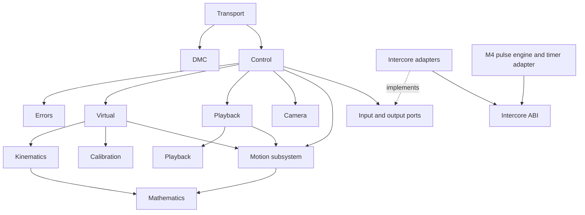

<!--
 Copyright 2026 cade.
 SPDX-License-Identifier: GPL-3.0-only
-->

# Modular firmware architecture

Status: proposed architecture and incremental migration plan. Work is organized
on `modules`, created from `main` at `d4a0a34` (which includes the virtuals work).
The analysis originated on `virtuals-test-suite`; historical branch references
describe that source, not a request to switch implementation baselines. No module
extraction is implied by the presence of these documents.

This overview was moved from `docs/modular-arch.md`. Each boundary document owns
its detailed responsibilities, contracts, validation, and discussion. The
[global TODO](TODO.md) is the single source for planned commit order and status.

[M01 working records](M01/README.md) contain the command baseline guide and
[DMC command inventory](M01/dmc-commands/README.md), including current code paths and
proposed module participation.

## Direction

Use small modules with explicit state ownership, value-based inputs and outputs,
and dependencies that point toward hardware-independent code. Keep the dual-core
split: M7 interprets commands and plans motion; M4 generates timed outputs.

Use **one motion subsystem with separate coordinated and independent planners**.
They need common axis state, limits, stop handling, and output timing, but have
different planning and handoff rules. A common interface should unify ownership
and execution without forcing both algorithms into one implementation.

In addition to packets, mathematics, kinematics, and motion, establish boundaries
for virtual control, playback and uploaded data, calibration, Errors module,
camera/GPIO sequencing, transport, and the Intercore module. These are logical
boundaries; each does not require a separate library, task, or abstract class.

## Current architecture and coupling

| Current location | Responsibilities and coupling |
| --- | --- |
| `m7/m7.ino` | Serial handling, dispatch, configuration, virtual state, playback, camera/GPIO, stops, reporting, motion updates, and shared-memory writes. These operate on the same global state. |
| `m7/dfx.h` | Mixes axis configuration, runtime state, trajectory storage, playback state, protocol scales, and macros that reach into global shared memory. |
| `m7/dmc_msg.*` | Incremental DMC parsing and response serialization, with global parser/output buffers. Command decoding and execution remain in the sketch. |
| `common/LimnmocoProtocol` | Host-tested complete-frame codec and initial typed virtual packet decoders. Not yet the firmware parser; no incremental stream parser or complete command/response coverage. |
| `common/LimnmocoIK` | Already contains reusable pure code, but combines vector/matrix math, geometry, calibration lookup, virtual target construction, wire conversion, and trajectory profiles. |
| `m7/motion.*` | Independent point-to-point planning, uploaded-track interpolation, and Go Motion/live-playback calculations. Functions mutate the broad `Motor` and playback structures. |
| `m7/coordinated_motion.*` | Coordinated execution and handoff with a private global state object; writes into the same `Motor` array used by independent motion and playback. |
| `m4/m4.ino` | Timer/GPIO setup, shared-memory consumption, pulse accumulation, pulse completion, and camera phase output. |

Specific pressures motivating the boundaries:

- `Motor` combines configuration, commanded position/velocity, and the private
  state of an independent trajectory. Coordinated motion clears fields belonging
  to that other planner to take control.
- Virtual target preparation, motion scheduling, and changes to logical aim
  state must succeed together. Splitting files alone will not establish that
  transaction.
- `updateMotorVelocities()` executes several motion modes, applies coupling,
  reconciles step counts, and publishes shared-memory output.
- `stopAll()` combines motion policy, repeated-stop escalation, playback state,
  frame alignment, and camera behavior.
- `DmcSharedData` is declared independently in both sketches. Its address and
  synchronization details are visible to application code.
- M4's accumulated steps are emitted-step accounting, not encoder measurements
  of the crane. Commanded and emitted positions must remain distinguishable.
- Serial tracing is embedded in kinematic reporting, and outgoing responses can
  be dropped when the current queue has insufficient room.

The existing [virtuals test-suite proposal](../proposal_virtuals_test_suite.md)
provides the starting migration strategy. This plan expands its virtual
controller boundary to cover the rest of the firmware.

## Boundary documents

| Boundary | Scope |
| --- | --- |
| [DMC](DMC.md) | DMC framing, streaming parser, typed payloads, and response codecs. |
| [Transport](transport.md) | Byte delivery, bounded output queues, and wire-to-domain command mapping. |
| [Mathematics](mathematics.md) | Pure vector, matrix, rotation, and general numerical operations. |
| [Kinematics and coordinate geometry](kinematics.md) | Pure FK/IK, coordinate frames, nodal geometry, aim, and line direction. |
| [Calibration](calibration.md) | Physical joints to motor steps, BCT, SPU, and optional-axis mapping. |
| [Motion subsystem](motion.md) | One axis-state owner with independent and coordinated execution. |
| [Virtual](virtual.md) | Virtual configuration, origin, aim, target transactions, and line-jog lifecycle. |
| [Playback](playback.md) | Bounded uploads, committed tracks, frame time, and shooting/playback lifecycle. |
| [Errors](errors.md) | Fault latches, allowed commands, stop escalation, and recovery decisions. |
| [Camera](camera.md) | Shutter/meter, triggers, blips, input debounce, and timing-domain ownership. |
| [Intercore](intercore.md) | Shared ABI, M7 publication, M4 pulse execution, and board-specific adapters. |
| [Control](control.md) | Composition, command policy, control-loop ordering, and event routing. |

The [Device](device.md) boundary owns the immutable identity, firmware metadata,
and assembled device-capacity description used by HI. It is now an agreed
thirteenth boundary alongside the 12 original boundaries.
Control routes configuration queries; DMC encodes
the response. Neither owns the underlying domain configuration by virtue of
handling a message about it.

The grouped boundaries retain distinct internal components: transport versus
dispatch, storage versus playback, and the Intercore module versus pulse/board
adapters. Motion keeps independent and coordinated planners behind one ownership
interface. Split a document further when its discussion warrants it, without
creating a new runtime module merely to match the documentation layout.

## Dependency and state contracts

The diagram shows permitted dependency direction, not execution order. Hardware
adapters implement ports declared at the domain boundary; domain code does not
include their implementations.



Key contracts:

- **One owner per mutable state.** Controllers request motion; only motion changes
  commanded axis state. M4 owns running emitted-step accumulation; resets are
  explicit synchronized link operations. Other modules use immutable snapshots.
- **Separate validation from commitment.** Prepare against a snapshot and
  configuration revision, validate every participant, then commit ownership,
  plans, and logical state together. Failed preparation leaves existing motion
  untouched. Use bounded candidate objects, not copies of the entire application.
- **A single tick authority.** Preserve the current 50 Hz execution cadence and
  M4 consumption handshake during extraction. Advance timelines only when an
  output interval is accepted. Supply tick/time explicitly for deterministic tests;
  wall-clock reporting and control time are distinct.
- **Explicit supersession.** Record outcomes for direct moves during a virtual
  group, virtual commands during playback, live-control axes, reconfiguration,
  position reset, and stop/fault. Preserve characterized behavior first; review
  corrections separately. Release or transfer the entire affected group.
- **Typed boundaries.** Distinguish axis IDs, virtual axes, degrees, millimetres,
  raw steps, frame indices, signed jog rates, and normalized trajectory progress.
  Wire-specific numbering and scaling terminate at the Transport.
- **Bounded work and memory.** No allocation or blocking I/O in the control tick
  or ISR. Bound transport work, event capacity, upload storage, and trace overhead.
  Measure memory and execution time as well as functional parity.
- **Events describe outcomes.** Completion, rejection, supersession, and fault
  results are domain values. The application routes them; the protocol adapter
  maps them into supported DMC messages without inventing wire extensions.

## Suggested source organization

Keep portable modules in host-buildable code and Arduino dependencies in the
sketch adapters. A possible grouping is:

```text
common/
  LimnmocoMath/src/          vectors, matrices, numerical helpers
  LimnmocoProtocol/src/      frames, incremental parser, payload codecs
  LimnmocoKinematics/src/    FK/IK, coordinates, aim and line geometry
  LimnmocoMotion/src/        axis types/state, planners, execution, coupling
  LimnmocoControl/src/       virtual, calibration, playback/store, fault, I/O
  LimnmocoIntercore/src/     shared ABI and portable pulse arithmetic
m7/
  m7.ino                    setup/loop and wiring
  adapters/                 command, serial, board, inter-core, diagnostics
m4/
  m4.ino                    setup/loop and wiring
  adapters/                 timer, GPIO, inter-core
tests/
  ...                       existing suites retained
  controller/               command sequences and arbitration
  motion/                   executor and stop simulation
  playback/                 uploads, frame progression, shooting
  intercore/                ABI, publication, pulse arithmetic
```

Directory names are provisional. Preserve Arduino library discovery and sketch
source compilation rules when arranging adapter sources; use flat sketch files
or the supported sketch `src/` tree as needed. Establish interfaces before doing
a bulk rename. `LimnmocoControl` groups related modules for packaging; it must not
expose one shared mutable context. Small shared domain types belong with their
owning module, not in a replacement omnibus `dfx.h`.

## Migration and tracking

The phase overview and proposed commit series live in [TODO.md](TODO.md). Keep
module-specific questions in their boundary file and cross-module rules here.
Proposed behavior changes must be distinguished from compatibility-preserving
extraction and receive their own acceptance criteria.

## Decisions still requiring focused review

1. Exact direct/virtual/playback supersession and recovery semantics, including
   whether any currently inconsistent behavior should change.
2. Continuous line-jog behavior after a rejected handoff and how an asynchronous
   failure is represented using existing DMC notifications.
3. Upload replacement behavior and memory budget; retaining two full moves is
   not the default assumption.
4. Inter-core publication, accumulator reset/read synchronization, and stale
   output policy. These require a hardware-specific review, not just host tests.
5. Supported board configurations and which camera/GIO timing contracts must be
   identical across GIGA and the existing Portenta conditional code.

The proposed default decisions are one motion subsystem, separate internal
planners, explicit controller state ownership, bounded direct interfaces, and an
incremental extraction from the current behavior baseline. The older
`typed-packet-rewrite` branch may inform packet design but is not the migration
base; implementation proceeds on `modules` from the recorded `main` baseline.
